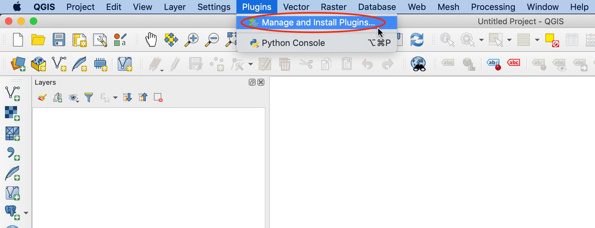
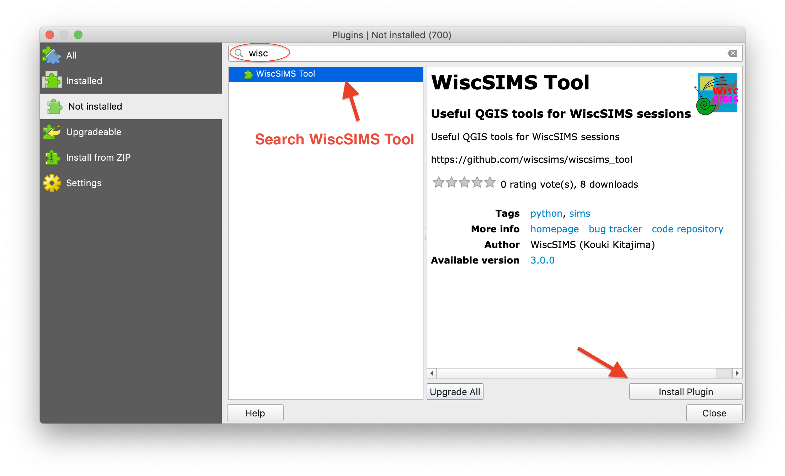
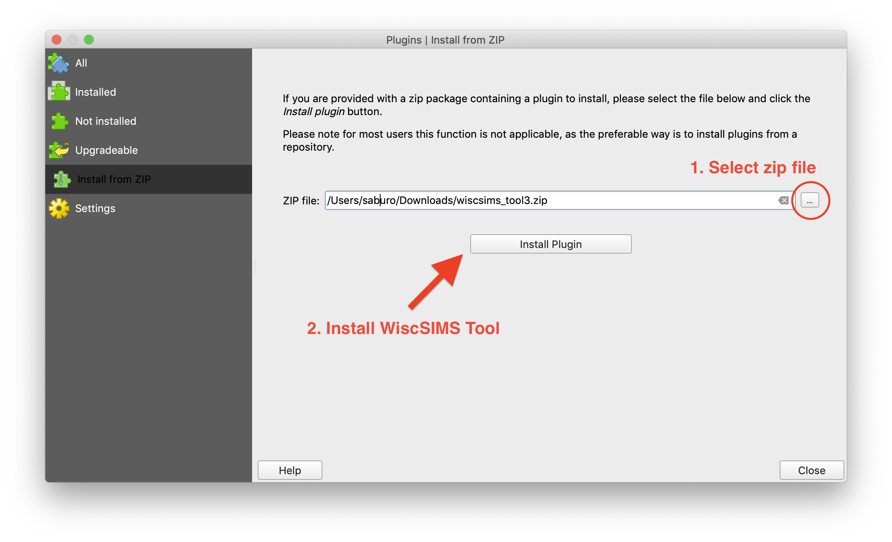
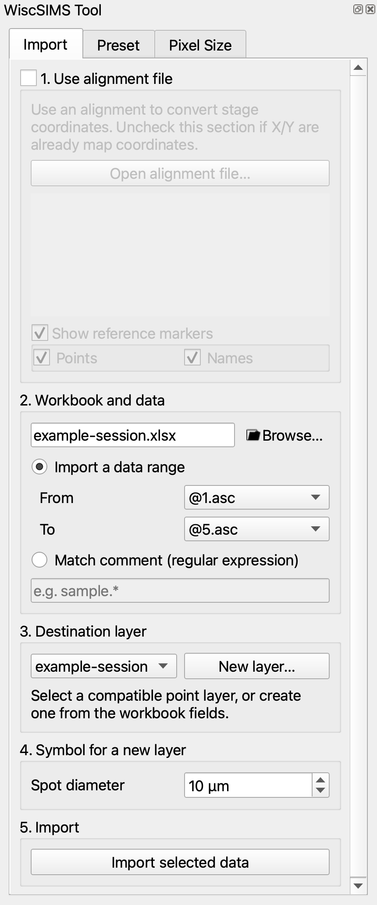
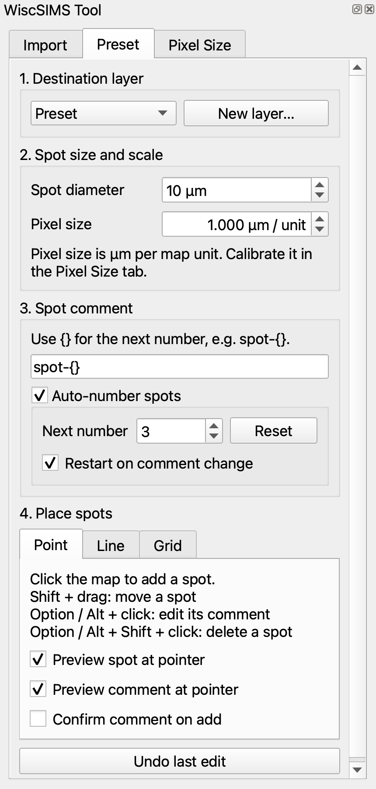
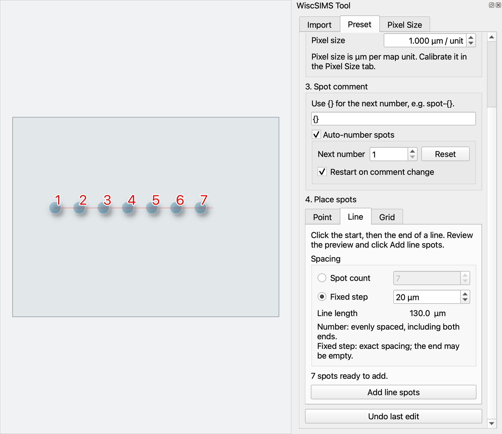
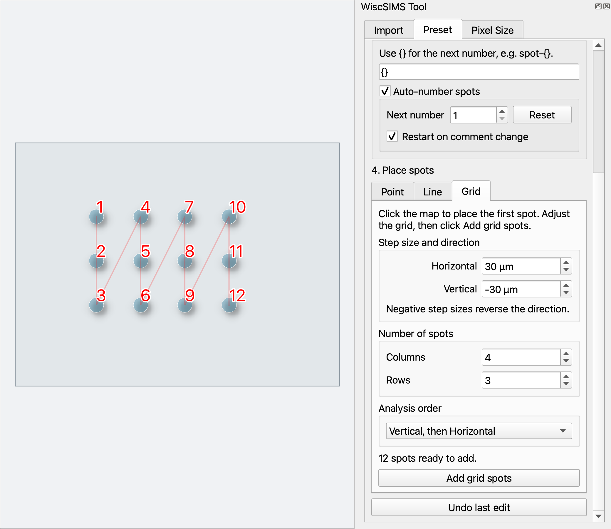

# WiscSIMS Tool

A QGIS 3 plugin for external and internal WiscSIMS users. It helps you import session data, pre-select SIMS spots on a map, and measure pixel size from a known scale bar.

## Table of Contents

- [Features](#features)
- [Requirements](#requirements)
  - [QGIS 3](#qgis-3)
- [Installation](#installation)
  - [Install from QGIS Plugin Repository](#install-from-qgis-plugin-repository)
  - [Install from ZIP file](#install-from-zip-file)
- [Usage](#usage)
  - [Import Data](#import-data)
    - [Alignment file](#alignment-file)
    - [Excel file](#excel-file)
    - [Data range](#data-range)
  - [Preset (pre-select SIMS spots on QGIS maps)](#preset-pre-select-sims-spots-on-qgis-maps)
    - [Layer](#layer)
    - [Scale](#scale)
    - [Comments](#comments)
    - [Preset Mode](#preset-mode)
    - [Preview](#preview)
    - [Undo](#undo)
    - [Modify spot locations](#modify-spot-locations)
    - [Modify comment](#modify-comment)
  - [Pixel Size](#pixel-size)
- [Development](#development)

## Features

WiscSIMS Tool has three main functions:

1. Import WiscSIMS session data from Excel workbooks into a QGIS point layer.
2. Pre-select SIMS spots on QGIS maps in the Preset tab.
3. Measure pixel size from a known length on the map and use it for preset spots.

## Requirements

### [QGIS 3](https://www.qgis.org/)

Version **3.40** requires **QGIS 3.44 or later in the QGIS 3 series**. The automated tests run with QGIS 3.44.13. QGIS 4 is not supported by this release. Download QGIS from the [official QGIS site](https://qgis.org/download/).

Excel import uses `openpyxl` for `.xlsx` files and `xlrd` for `.xls` files. If the required module is missing when you select a workbook, the plugin asks whether it may install the module into the current user's QGIS Python environment. Automatic installation requires an internet connection. You can decline without changing the environment.

## Installation

There are two ways to install WiscSIMS Tool. The screenshots below show an older QGIS interface; button placement may differ in your version.

### Install from QGIS Plugin Repository

1. Open QGIS and select **Plugins > Manage and Install Plugins**.

   

2. Search for **WiscSIMS Tool** in the [QGIS Plugin Repository](https://plugins.qgis.org/plugins/wiscsims_tool/) and click **Install Plugin**.

   

3. Check **Installed Plugins** to confirm that it is enabled. You should also see its icon in the QGIS toolbar.

This checkout targets **WiscSIMS Tool 3.40**. The published repository package may be an earlier version until the new release is submitted and approved.

### Install from ZIP file

Manual installation is also available.

1. Download a packaged plugin ZIP from the [WiscSIMS Tool releases](https://github.com/wiscsims/wiscsims_tool/releases), or package the version of this checkout that you want to use.
2. In QGIS, select **Plugins > Manage and Install Plugins**.
3. Select **Install from ZIP**, choose the ZIP file, and click **Install Plugin**.

   

4. Check **Installed Plugins** to confirm that it is enabled.

## Usage

New to QGIS? Follow the [Quick Start](docs/wiki/WiscSIMS-Tool-Quick-Start.md) to choose your first spot. Image calibration is explained in the separate [Pixel Size guide](docs/wiki/Estimate-Pixel-Size-of-the-image.md).

Release ZIPs omit the large GIF and MP4 recordings. The [Pixel Size demonstration](https://github.com/wiscsims/wiscsims_tool/blob/main/docs/wiki/Estimate-Pixel-Size-of-the-image.md#watch-the-measurement) remains available online, and the full workflow recordings are retained in the source repository.

Open the dock from its toolbar button or **Plugins > WiscSIMS > WiscSIMS Tool**. The dock has **Import**, **Preset**, and **Pixel Size** tabs. Keep the WiscSIMS Tool map tool active when selecting locations on the map.

The dock can be widened and follows the QGIS font and display scaling settings, including high DPI displays. Each tab scrolls vertically when space is limited. Size inputs and layer selectors only respond to the mouse wheel when focused, to avoid accidental changes while scrolling.

The usage screenshots below were captured from the current plugin widgets and QGIS map canvas with QGIS 3.44.13 at 200% display scaling. They use sample data and the microscopy image shown in the Pixel Size example. Click a UI screenshot to see it at full resolution. The Line and Grid screenshots show the dock scrolled down to the placement controls.

### Import Data

After a WiscSIMS session, use the **Import** tab to add data from a session workbook to a QGIS point layer. You can convert stage coordinates with an alignment file or import coordinates directly.

*Example: **Use alignment file** is checked and **GLP (MonkeyNavigator2)** is selected. The selected range contains five data files, ready to convert from stage coordinates and append to `example-session` with **Import selected data**.*

#### Alignment file

If you have a Stage Navigator alignment `.json` file, load it under **Use alignment file**. The plugin uses the alignment to transform stage coordinates to map coordinates. You can inspect the reference points in the dock, and loading the alignment updates the Preset pixel size. For MonkeyNavigator2 alignments, the new-layer spot size is also set from the mean beam size of the enabled references.

Under **Import conversion**, choose **Current (reference pairs)** for the existing nearest-pair conversion, or **GLP (MonkeyNavigator2)** for points exported using MonkeyNavigator2's Global + Local Plane model. Current remains the default; the export model is not recorded in the alignment JSON, so select GLP explicitly.

GLP import inverts MonkeyNavigator2's forward model and verifies each result. Load the **same alignment file and enable the same references used for export**. GLP requires at least four usable references in the MonkeyNavigator2 alignment format; its reference validation also checks beam information, matching MonkeyNavigator2. The model combines a global similarity fit with a local residual plane using the nearest 12 references. It keeps fractional coordinates; the original Excel `X` and `Y` attributes remain stage coordinates.

If no consistent inverse is found, local geometry is singular, or multiple matching map positions are found, a review dialog lists all affected files under **Show Details** before any points are added. **Cancel** is the default and leaves the layer unchanged. You can explicitly choose **Import … verified points** to skip the affected files and import only the verified positions; the completion message reports how many were skipped. There is no automatic fallback to Current or an approximate position. Exact return to a planned spot also depends on preserving the exported stage-coordinate precision; measured or rounded coordinates can differ.

Choose **Use reference pairs for affected points** to import the failed GLP points with the usual **Current (reference pairs)** conversion. Verified GLP points keep their GLP positions. The completion message reports how many points used reference pairs. These pair-converted positions are not verified GLP inverses. If pair conversion or attribute validation fails, no points are written.

Changes in the nearest-12 reference set can create small discontinuities, so some measured or rounded stage positions may have no exact GLP inverse. The error includes the best attempted forward residual in µm when available; it does not silently accept an approximate position.

If the workbook's `X` and `Y` values are already map coordinates, uncheck **Use alignment file** to import them directly.

#### Excel file

1. Click **Browse…** under **Workbook and data** and choose a `.xlsx` or `.xls` file. The workbook controls become available after a usable alignment is loaded or alignment is turned off.
2. The workbook needs a sheet named `Sum_table` or `Data`. Its first row supplies field names; data rows need a first-column filename such as `20240929@1.asc` and `X` and `Y` columns. **Match comment** also needs a `Comment` column.
3. Select a compatible, visible point layer under **Destination layer**, or click **New layer…** to make a new ESRI Shapefile with fields from the workbook. **Symbol for a new layer** sets the symbol size of a new layer.
4. Click **Import selected data**. Valid rows are appended to the chosen layer; rows without usable numeric coordinates are skipped.

New layers use numeric fields for numeric columns and text fields for columns containing text, dates, or times. Dates and times are stored as ISO text, and empty cells become NULL. If an existing layer has incompatible field types, the import stops before adding points; create a new layer from the workbook.

A progress dialog shows the current operation while reading Excel or importing points: opening the workbook, reading worksheet rows, checking coordinates and attributes, and writing to the destination layer. Row counts are shown during reading and validation. Workbook reading runs in the background; loaded rows are reused for range and comment selection.

#### Data range

Use **Import a data range** to import rows between selected `.asc` filenames. Alternatively, use **Match comment** to filter the `Comment` column with a case-insensitive regular expression.

The selected spot count updates as you change the range or comment filter. Invalid regular expressions are indicated beside the selection controls.

The **From** and **To** lists show the part after the date, such as `@1.asc`; the underlying workbook filename still needs the full `YYYYMMDD@number.asc` format.

### Preset (pre-select SIMS spots on QGIS maps)

Use the **Preset** tab to place spots on a QGIS point layer before SIMS analysis. Work from top to bottom: choose a **Destination layer**, set **Spot size and scale**, enter the **Spot comment**, then choose **Point**, **Line**, or **Grid** under **Place spots**. Each mode includes its map controls on screen.

*Example: spots have a 10 µm diameter and a pixel size of 1 µm per map unit. Two spots have been added, so **Next number** is 3 and the next comment will be `spot-3`.*

#### Layer

Preset layers must be point vector layers with a field named `Comment` and a single symbol renderer. Select an existing layer, or click **Destination layer > New layer…** to create a new ESRI Shapefile. A new preset layer also has fields for spot size and pixel size. The list updates when layers are added or removed. If no compatible layer is available, the dock shows how to create or add one.

#### Scale

Set **Spot diameter** in µm and **Pixel size** in µm per map unit (shown as `µm / unit`). The diameter saved for the spot symbol in map units is `spot size / pixel size`. Loading an alignment file in **Import** updates the Preset pixel size. You can also enter it manually or calculate it in the **Pixel Size** tab.

For example, a 10 µm spot at 0.5 µm per map unit has a symbol diameter of 20 map units. Changing the spot diameter or pixel size also sets the selected layer's symbol units to **Map Units**, including an existing layer that previously used millimeters.

#### Comments

Comments are saved with preset points in the selected layer. With **Auto-number spots** enabled, a Python format placeholder in the comment is replaced by the current number. For example, `spot-{:04}` produces `spot-0001` when the number is 1. See Python's [format specification](https://docs.python.org/3/library/string.html#format-specification-mini-language).

Use **Next number** to choose the number for the next spot. **Reset** returns it to 1. **Restart on comment change** starts the sequence again when you edit the comment template. In Point mode, **Confirm comment on add** opens an editor before each spot is added.

#### Preset Mode

**Point:** Left click the sample image on the map to add a spot immediately. With **Confirm comment on add** enabled, edit or confirm its comment before adding it. The Point screenshot above shows the available preview and comment options.

Line and Grid each allow up to 5,000 spots per placement. The add button stays disabled until a valid preview is ready. A status message shows the number of spots ready to add, the next action, or why a preview cannot be added.

##### Line

1. Select **Line** and choose a spacing method: **Spot count** includes both endpoints at even intervals; **Fixed step** uses an exact spacing in µm from the start.
2. Left click to set the start point. Move the pointer to preview the line, then left or right click to set its end point.
3. Review **Line length**, the preview, and the number of spots ready to add. Click **Add line spots** to save them.

In Fixed step mode, the endpoint gets a spot only when it falls on the interval. A line shorter than one interval has just the start spot. The disabled **Spot count** field shows the calculated number of spots.

*Example: a 130 µm line with a 20 µm fixed step creates seven spots at 0, 20, 40, 60, 80, 100, and 120 µm from the start. The final 10 µm remains empty, preserving the chosen step size. The comment template is `{}` so the preview labels show only numbers.*

##### Grid

1. Select **Grid**. Set the horizontal and vertical step sizes in µm, **Columns**, **Rows**, and **Analysis order**.
2. Left click to place the first spot and inspect the preview. Adjust the settings or click another location to reposition the grid.
3. Check the number of spots ready to add, then click **Add grid spots** to save them.

Negative step sizes reverse direction. The preview follows the current map rotation. **Horizontal, then Vertical** numbers across a row before starting the next row; **Vertical, then Horizontal** numbers down a column before starting the next column.

*Example on an unrotated map: 4 columns × 3 rows creates 12 spots. With steps of 30 µm horizontally and −30 µm vertically, the grid extends right and down from its first spot. **Vertical, then Horizontal** gives spots 1–3 in the first column, 4–6 in the next, and so on. The comment template is `{}`.*

#### Preview

In Point mode, **Preview spot at pointer** shows a spot circle at the pointer. **Preview comment at pointer** shows the next comment beside the pointer and works independently of the circle. The circle resizes after zooming, with a minimum on-screen diameter of 16 pixels so it stays visible when zoomed far out. This display minimum does not alter the spot size saved to the layer. Line and Grid show the candidate spots on the map before you click their add button.

#### Undo

Click **Undo last edit** to reverse a recent spot addition, movement, comment edit, or deletion. The button is enabled when there is an action to undo.

#### Modify spot locations

Hold **Shift** and drag an existing spot to move it. To move multiple features, use QGIS's built-in feature editing tools.

#### Modify comment

Hold **Alt** (or **Option** on macOS) and click an existing spot to open its comment editor. Clicking empty space does nothing. The dialog also offers deletion. To delete a spot directly, hold **Alt + Shift** (or **Option + Shift** on macOS) and click it; confirm the deletion when prompted.

### Pixel Size

Use the **Pixel Size** tab to calibrate an image from its scale bar. In the microscopy image below, the bar is labeled **1000 µm**, so its two endpoints represent a real distance of 1000 µm.

*The orange line shows the measurement between the two black end ticks. This is a QGIS map canvas capture zoomed around the scale bar; click it to open the original image.*

*Watch the complete operation in the GIF or the [retained MP4 video](img/readme/pixel-size-measurement.mp4). The blue circle highlights the pointer; click the animation to view it at full resolution. The measurement line is fixed at the clicked end ticks. This recording uses a separate pair of clicks on the same image, giving approximately 0.87 µm per map unit.*

1. Load the image into QGIS, activate WiscSIMS Tool, and select **Pixel Size**.
2. Under **Measure on the map**, zoom in until you can see both small black vertical ticks at the ends of the scale bar. Left click the left tick, then the right tick. The plugin draws the measurement line and fills in **Start**, **End**, and **Measured distance**.
3. Under **Enter known length**, enter **1000** in **Real length of the scale bar**, using the µm label printed on this image.
4. Check the calculated value under **Apply the result**, then click **Apply pixel size to Preset**. This copies the calibration to Preset and switches to that tab.

| Value | Where it comes from | This example |
| --- | --- | --- |
| **Measured distance** | Calculated from the two clicks on the map | 1148.5 map units |
| **Real length of the scale bar** | Enter the length printed on the image | 1000 µm |
| Pixel size under **Apply the result** | Known length divided by measured distance | Displayed as 0.87 µm / map unit |

The calculation is `1000 / 1148.5 ≈ 0.8707 µm / map unit`, displayed as **0.87** in this example. Applying it lets Preset convert a spot diameter in µm into the corresponding diameter in map units.

The measured distance depends on the image's map coordinates. Use the distance reported by your own measurement; 1148.5 is the value for this example. A map unit represents a pixel only when the map coordinates use image pixels. Click the map again to start another measurement.

## Development

See the [development guide](docs/development.md) for module responsibilities, coordinate units, cleanup rules and test commands.
