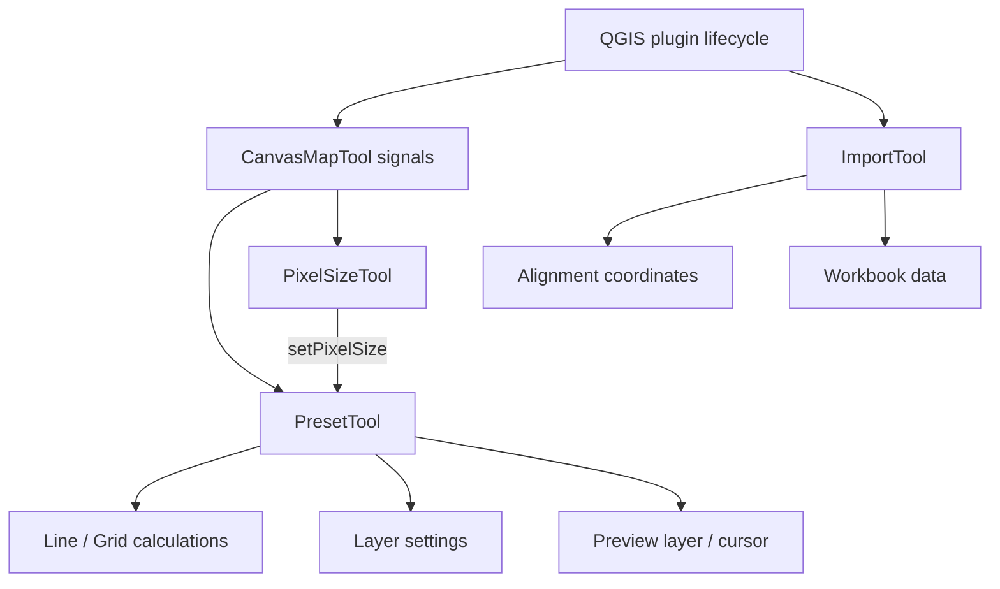

# Development guide

## Code responsibilities

Preset placement calculations are independent of Qt and QGIS.

| Module | Responsibility |
| --- | --- |
| `wiscsims_tool.py` | QGIS plugin lifecycle, menu and toolbar, routing map events to the active tool |
| `tools/canvasMapTool.py` | Translate mouse and keyboard events into Qt signals |
| `ui/wiscsims_tool_dockwidget.py` and `.ui` | Dock controls, scrolling, help text and native font sizing |
| `tools/preset/presetTool.py` | Coordinate Preset controls, preview state, point edits and undo |
| `tools/preset/placement.py` | Calculate Line and Grid positions, validate spacing and point limits |
| `tools/preset/layer_settings.py` | Create preset shapefiles, read/write size settings, set symbol units |
| `tools/preset/presetPreview.py` | Temporary placement layer and pointer marker/text, including zoom updates |
| `tools/pixelsize/pixelSizeTool.py` | Scale-bar measurement and applying the pixel size to Preset |
| `tools/imports/importTool.py` | Alignment/workbook selection and importing data to a layer |
| `tools/imports/coordinateTool.py` | Current and legacy alignment coordinate transformations |
| `tools/imports/alignmentMarker.py` | Reference markers and annotations owned by the Import tool |
| `tools/imports/sumTableTool.py` | Workbook loading, row ranges and comment filters |
| `tools/imports/globalLocalPlane.py` | Vendored MonkeyNavigator2 forward GLP; source SHA256 is recorded in the header |
| `tools/imports/glpInverse.py` | Matching reference validation, cached local affine inverses and verification with the forward GLP |
| `tools/layerTool.py` | Query layers in legend order and exclude temporary layers |
| `tools/dependencyInstaller.py` | Confirm and install optional Excel readers in the user's QGIS Python environment |
| `tools/operationProgress.py` | Show import stages and run Python-only workbook I/O in a worker thread |
| `tools/signal_connections.py` | Track and release subscriptions to long-lived QGIS objects |



## Behavior to preserve

- Physical spot diameter and spacing are specified in µm. Preset's `scale` is `1 / pixel_size` and converts these values to map units.
- Fixed-step Line placement stops at the last multiple of the requested spacing. It does not append a shorter final interval. Count mode includes both endpoints.
- Grid order 0 is horizontal then vertical; order 1 is vertical then horizontal. Signed steps reverse an axis, and rotation is around the first spot.
- Line/Grid placement is limited to 5,000 points before allocating the preview.
- The existing `Comment`, `ss_<spot size>` and `ps_<pixel size>` shapefile fields remain compatible. Missing or malformed size fields use 10 µm and 1 µm per map unit. Updating size fields preserves an already-open layer edit session.
- Marker size updates use the top-level symbol's `setOutputUnit(MapUnits)`, which also updates the unit shown in Layer Properties.
- Alt/Option-click edits existing spots; it does not add a point. Shift dragging preserves the offset between the pointer and the spot center.
- Undo records retain a layer ID, so changing the selected layer does not redirect undo to another layer.
- The pointer marker uses a canvas item rather than editing/repainting a layer on each mouse movement. Its minimum screen diameter and zoom updates must remain intact.

## Object ownership and cleanup

`PresetTool` and `PixelSizeTool` are QObject children of the dock. Each tool explicitly releases its canvas items before the dock is deleted. Pixel Size reuses one rubber band across measurements. Import refresh removes only the reference markers and annotations that it created.

Layer-tree signals may fire synchronously when a layer is registered or removed. Keep Preset's combobox rebuild guard and preserve the previous signal-blocking state when loading controls. Configure a new preset layer before adding it to the project.

On dock close, the plugin disconnects project/UI signals, restores the previous map tool, calls the tool cleanup methods, and schedules dock deletion. `unload()` flushes pending dock deletion so Plugin Reloader does not retain old widgets. New subscriptions to the canvas or layer tree need matching cleanup; `SignalConnections` groups these subscriptions and supports repeated disconnection.

Keep generated `resources.py` out of manual edits. Historical public handler names and widget object names remain in several modules; update their callers together if renaming them.

Excel readers are optional so the plugin can start without them. Workbook selection calls `DependencyInstaller` before constructing `SumTableTool`. Package names are selected from a fixed extension mapping; do not pass user-controlled package names to pip. Installation resolves QGIS's bundled Python interpreter and runs it with `pip install --user`, only after the user accepts the confirmation dialog. Do not use `sys.executable` directly because a GUI QGIS session may report the QGIS application binary instead of Python. On macOS, the child process must also receive the app bundle's `Contents/Frameworks` directory as `PYTHONHOME`; without it, the bundled interpreter cannot load its standard library.

Excel selection reads and caches headers/rows in a worker thread before updating dock controls. `SumTableTool` stays independent of Qt and reports row progress through an optional callback; `reload_workbook()` clears its cache. Keep QGIS layer access and widget updates on the GUI thread. Import validation periodically processes paint events, and the modal progress dialog prevents duplicate operations. Destination writes run on the GUI thread and use an indeterminate progress bar because the provider does not expose row progress.

### GLP import

Current remains the default. GLP uses the same enabled/complete reference rules as MonkeyNavigator2's `referenceValidation.py`, including beam validity and its FOV bounds. Keep these rules and the vendored forward implementation synchronized when MonkeyNavigator2 changes. GLP operates only on the current alignment format. The fit cache uses the ordered reference row/canvas/stage snapshot; changing coordinates or enabled/valid states invalidates it before another import.

For each nearest-12 canvas reference set the forward GLP is affine. The inverse solves that affine map, checks that the result selects the same nearest reference set, and verifies the original forward prediction within 1e-6 stage µm (or a larger tolerance required by floating-point resolution). Seeds come from the inverse global similarity and the nearest 12 stage references; changed neighborhoods are followed up to 128 distinct sets. A discovered second solution is rejected. This is a bounded search, not a proof of global uniqueness for arbitrary folded/discontinuous calibrations. Singular geometry, failed verification, ambiguity or an exhausted search rejects that point. All rejected filenames and diagnostics are collected before any provider write; a review dialog defaults to Cancel. The user may explicitly import only verified GLP points or use Current reference pairs for rejected points. The shared `convert_with_reference_pairs` method keeps this fallback identical to regular Current imports. GLP successes are retained, Excel row order is preserved, and all fallback geometry and attributes are checked before a single provider write. Failed fallback, invalid global calibration or incompatible attributes aborts the whole batch. Do not replace the GLP inverse with a GLP fit trained on swapped coordinates; that is a different model and is not an export inverse.

## Release settings and packaging

Release 3.40.1 targets QGIS 3.44 through 3.99. Keep the public name `WiscSIMS Tool` and the package directory `wiscsims_tool` when updating the existing QGIS repository entry. Excel dependencies and their installation prompt are documented in `metadata.txt`.

The dock UI loader reads only its bundled `.ui` file and substitutes the exact local custom widget header with the installed package name. Keep the header unique. Do not add a general XML parser for this substitution; the previous ElementTree import and parse call were rejected by the repository's security scan.

Create the submission archive from the final committed release revision:

```sh
git archive --format=zip --prefix=wiscsims_tool/ --output=/tmp/wiscsims_tool-3.40.1.zip HEAD
```

The tracked `.gitattributes` excludes tests, recording scripts, GIF/MP4 recordings, the old README PDF and Git configuration from the archive. The recordings remain in GitHub for the online guides. Untracked alignment, Shapefile and database files are never included by `git archive`. Runtime modules, UI files, icons, `metadata.txt`, `__init__.py` and `LICENSE` must be present. Check that the ZIP is below the repository's 25 MB limit and install it in a disposable QGIS profile before submission. Published source and the ZIP must correspond to the same release revision.

## Run tests

The placement tests need only Python:

```sh
python3 -m unittest discover -s tests -p 'test_placement.py'
```

Run the complete suite with Python that can import QGIS, Qt, GDAL and the workbook dependencies:

```sh
QT_QPA_PLATFORM=offscreen python3 -m unittest discover -s tests
```

For the macOS QGIS bundle used in this repository:

```sh
PYTHONHOME=/Applications/QGIS.app/Contents/Frameworks \
QT_QPA_PLATFORM=offscreen \
PYTHONWARNINGS=ignore \
/Applications/QGIS.app/Contents/MacOS/python3.12 -m unittest discover -s tests
```

Tests requiring unavailable QGIS bindings are skipped by ordinary Python. Check for skipped tests before treating that run as a complete verification. The QGIS integration tests cover map-click routes, fixed-step placement, grid order/rotation, size units, layer removal, point editing, undo, measurement endpoints, preview text/zoom, and plugin reload cleanup. UI tests exercise native fonts and enlarged fonts; run them with `QT_SCALE_FACTOR=2` for an additional high-DPI check.
