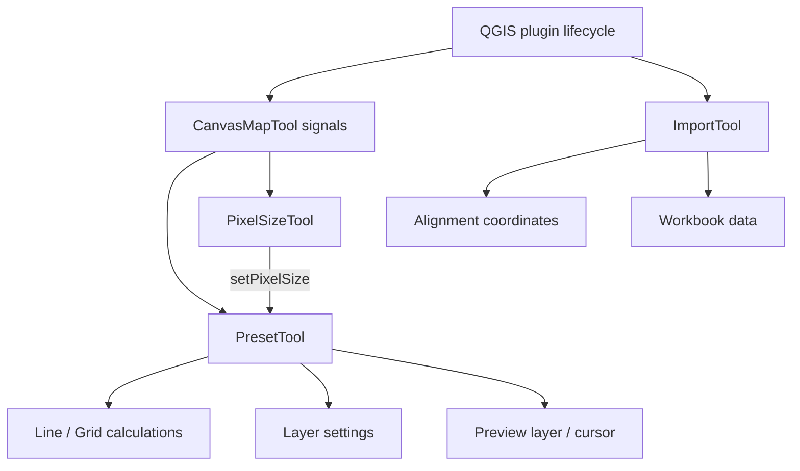

# Development guide

## Code responsibilities

Preset placement calculations are independent of Qt and QGIS.

| Module | Responsibility |
| --- | --- |
| `wiscsims_tool.py` | QGIS plugin lifecycle, menu and toolbar, routing map events to the active tool |
| `tools/canvasMapTool.py` | Translate mouse and keyboard events into Qt signals |
| `ui/wiscsims_tool_dockwidget.py` and `.ui` | Dock controls, scrolling, help text and native font sizing |
| `tools/preset/presetTool.py` | Coordinate Preset controls, preview state, point edits and undo |
| `tools/preset/placement.py` | Calculate Line and Grid positions, validate spacing and point limits |
| `tools/preset/layer_settings.py` | Create preset shapefiles, read/write size settings, set symbol units |
| `tools/preset/presetPreview.py` | Temporary placement layer and pointer marker/text, including zoom updates |
| `tools/pixelsize/pixelSizeTool.py` | Scale-bar measurement and applying the pixel size to Preset |
| `tools/imports/importTool.py` | Alignment/workbook selection and importing data to a layer |
| `tools/imports/coordinateTool.py` | Current and legacy alignment coordinate transformations |
| `tools/imports/alignmentMarker.py` | Reference markers and annotations owned by the Import tool |
| `tools/imports/sumTableTool.py` | Workbook loading, row ranges and comment filters |
| `tools/layerTool.py` | Query layers in legend order and exclude temporary layers |
| `tools/signal_connections.py` | Track and release subscriptions to long-lived QGIS objects |



## Behavior to preserve

- Physical spot diameter and spacing are specified in µm. Preset's `scale` is `1 / pixel_size` and converts these values to map units.
- Fixed-step Line placement stops at the last multiple of the requested spacing. It does not append a shorter final interval. Count mode includes both endpoints.
- Grid order 0 is horizontal then vertical; order 1 is vertical then horizontal. Signed steps reverse an axis, and rotation is around the first spot.
- Line/Grid placement is limited to 5,000 points before allocating the preview.
- The existing `Comment`, `ss_<spot size>` and `ps_<pixel size>` shapefile fields remain compatible. Missing or malformed size fields use 10 µm and 1 µm per map unit. Updating size fields preserves an already-open layer edit session.
- Marker size updates use the top-level symbol's `setOutputUnit(MapUnits)`, which also updates the unit shown in Layer Properties.
- Alt/Option-click edits existing spots; it does not add a point. Shift dragging preserves the offset between the pointer and the spot center.
- Undo records retain a layer ID, so changing the selected layer does not redirect undo to another layer.
- The pointer marker uses a canvas item rather than editing/repainting a layer on each mouse movement. Its minimum screen diameter and zoom updates must remain intact.

## Object ownership and cleanup

`PresetTool` and `PixelSizeTool` are QObject children of the dock. Each tool explicitly releases its canvas items before the dock is deleted. Pixel Size reuses one rubber band across measurements. Import refresh removes only the reference markers and annotations that it created.

Layer-tree signals may fire synchronously when a layer is registered or removed. Keep Preset's combobox rebuild guard and preserve the previous signal-blocking state when loading controls. Configure a new preset layer before adding it to the project.

On dock close, the plugin disconnects project/UI signals, restores the previous map tool, calls the tool cleanup methods, and schedules dock deletion. `unload()` flushes pending dock deletion so Plugin Reloader does not retain old widgets. New subscriptions to the canvas or layer tree need matching cleanup; `SignalConnections` groups these subscriptions and supports repeated disconnection.

Keep generated `resources.py` out of manual edits. Historical public handler names and widget object names remain in several modules; update their callers together if renaming them.

## Run tests

The placement tests need only Python:

```sh
python3 -m unittest discover -s tests -p 'test_placement.py'
```

Run the complete suite with Python that can import QGIS, Qt, GDAL and the workbook dependencies:

```sh
QT_QPA_PLATFORM=offscreen python3 -m unittest discover -s tests
```

For the macOS QGIS bundle used in this repository:

```sh
PYTHONHOME=/Applications/QGIS.app/Contents/Frameworks \
QT_QPA_PLATFORM=offscreen \
PYTHONWARNINGS=ignore \
/Applications/QGIS.app/Contents/MacOS/python3.12 -m unittest discover -s tests
```

Tests requiring unavailable QGIS bindings are skipped by ordinary Python. Check for skipped tests before treating that run as a complete verification. The QGIS integration tests cover map-click routes, fixed-step placement, grid order/rotation, size units, layer removal, point editing, undo, measurement endpoints, preview text/zoom, and plugin reload cleanup. UI tests exercise native fonts and enlarged fonts; run them with `QT_SCALE_FACTOR=2` for an additional high-DPI check.
