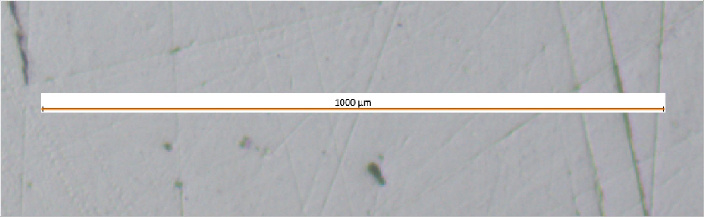
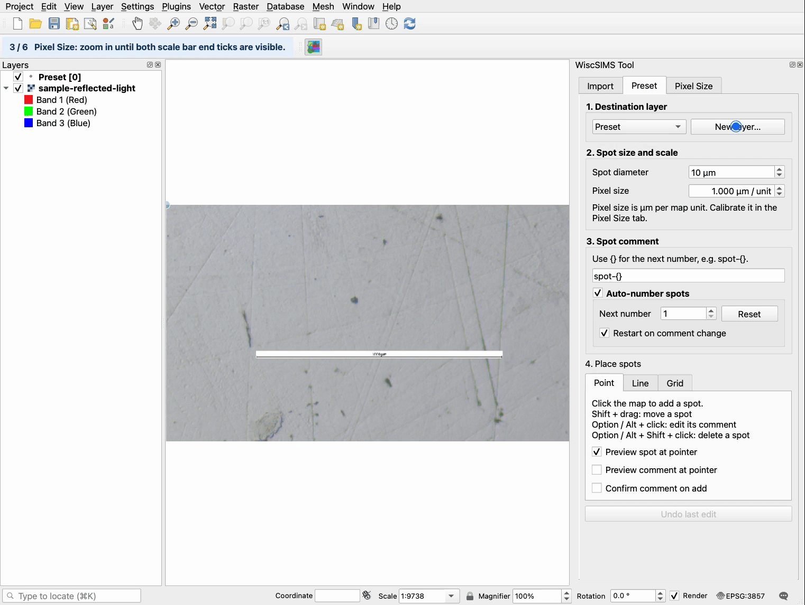
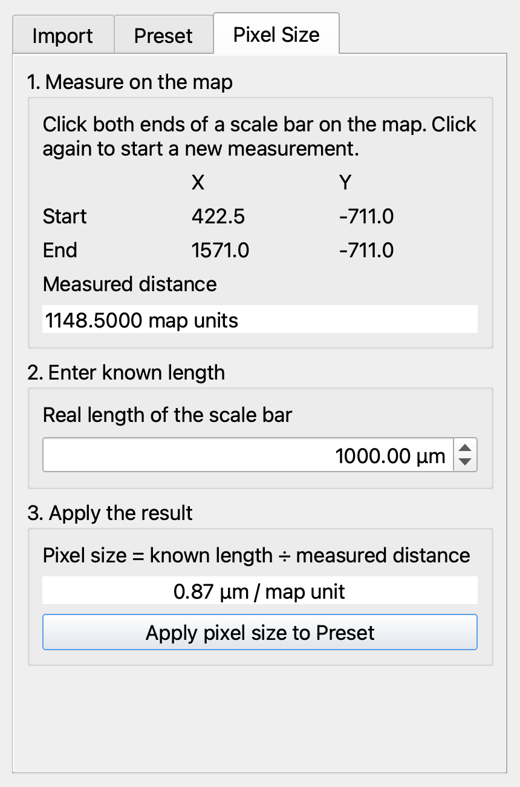

# Measure Pixel Size

Use this page when you need to set the image scale before choosing your first spot. Measure a known scale bar in **Pixel Size**, then apply the result to **Preset**.

## Choose the scale bar endpoints

The microscopy image below has a scale bar labeled **1000 µm**. Use the small black vertical ticks at the left and right ends as your click positions.

*The orange line is the plugin's measurement. Click the image to open the original microscopy image.*

## Watch the measurement

*The blue circle highlights the pointer. Click the GIF to view it at full resolution.*

[Watch the retained MP4 video](../../img/readme/pixel-size-measurement.mp4). This clip and the GIF are derived from the [complete Quick Start recording](../../img/readme/quick-start-complete.mp4). After the second click, the orange line connects the two selected ticks.

## Measure and apply

1. Load your sample image into QGIS and activate the WiscSIMS Tool map tool.
2. Select **Pixel Size**.
3. Left click the scale bar's left end tick, then its right end tick. **Measured distance** is filled in from the map coordinates.
4. Enter **1000** in **Real length of the scale bar** for this image, whose printed length is 1000 µm.
5. Check the calculated pixel size, then click **Apply pixel size to Preset**. This copies the result to **Preset > Spot size and scale > Pixel size** and switches to Preset.

You can measure pixel size before creating a preset layer. To start another measurement, click the map again.

## Read the result

| Value | Source | Still screenshot example |
| --- | --- | --- |
| **Measured distance** | The two selected map positions | 1148.5 map units |
| **Real length of the scale bar** | The label printed on the image | 1000 µm |
| Pixel size under **Apply the result** | Known length divided by measured distance | Displayed as 0.87 µm / map unit |

The still screenshot gives `1000 / 1148.5 ≈ 0.8707 µm / map unit`. The GIF uses separately selected endpoints and also gives approximately 0.87 µm per map unit. The measured distance may differ slightly with the click positions; always use the measurement for your own image.

A map unit represents a pixel only when the map coordinates use image pixels. For a positioned or georeferenced image, the plugin uses the distance in its map coordinates.

Once applied, Preset calculates spot diameter in map units as `spot diameter in µm / pixel size`. Set **Spot diameter** for selecting your spots. For a 10 µm analysis spot, use about 12 µm to allow 20% extra margin.

Return to [Quick Start, step 4](WiscSIMS-Tool-Quick-Start.md#4-set-scale-and-spot-size) to set the spot diameter and choose your first point.
