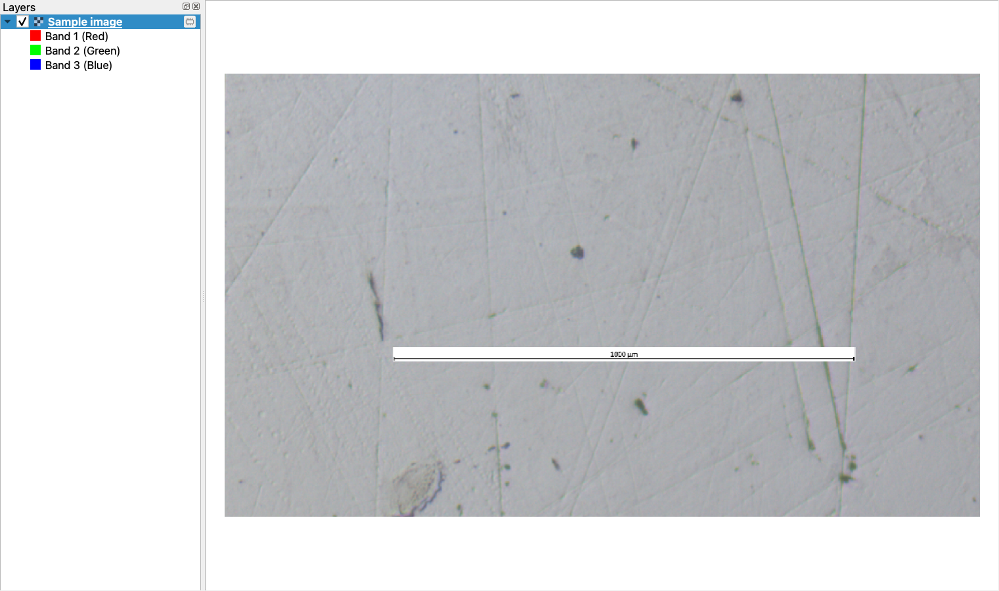
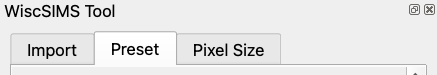
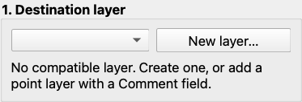
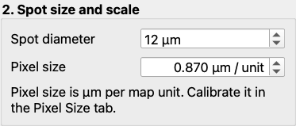
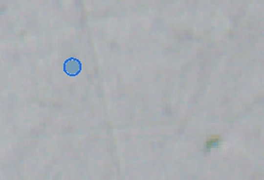

# WiscSIMS Tool Quick Start

Use **QGIS 3.44 or later in the QGIS 3 series**. Install **WiscSIMS Tool** through **Plugins > Manage and Install Plugins**.

## 1. Open your image

Put your reflected light image in a session folder. Open QGIS and drag the image onto the map.

## 2. Open WiscSIMS Tool

Choose **Plugins > WiscSIMS > WiscSIMS Tool**, then select **Preset**.

## 3. Create a spot layer

Under **Destination layer**, click **New layer…** and save `spots.shp` in your session folder.

## 4. Set scale and spot size

Enter your image's **Pixel size**. If unknown, follow the separate [Pixel Size guide](Estimate-Pixel-Size-of-the-image.md), then return here.

For a **10 µm** analysis spot, we recommend **Spot diameter = 12 µm** to allow about **20% extra margin** when choosing locations.

*The pixel size shown is an example. Use the value for your own image.*

## 5. Choose your first spot

Select **Point**, enter a **Spot comment** such as `spot-1`, and left click the image to add your first spot. To try again, click **Undo last edit**.

Choose **Project > Save As…** and save in your session folder. Keep the project, image and all spot layer files together.

For more features, see the [README](../../README.md#usage).
